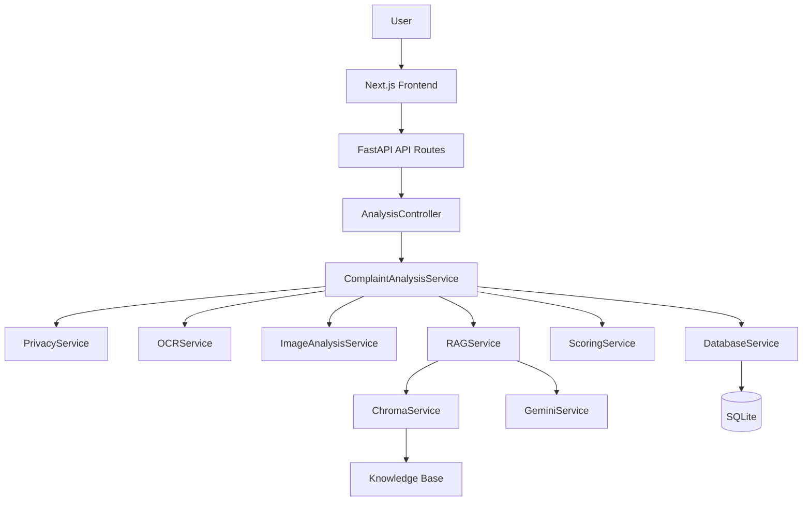
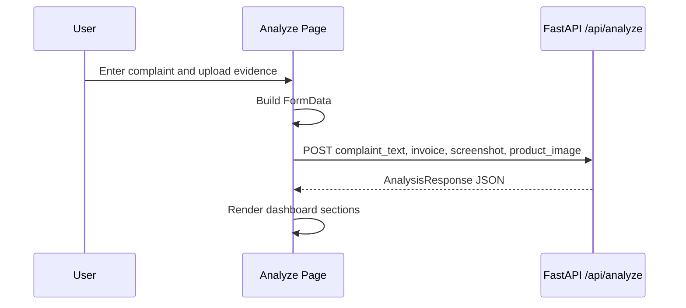
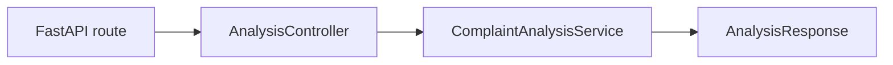
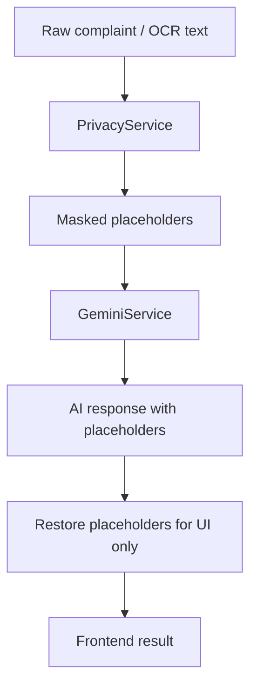
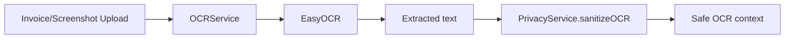
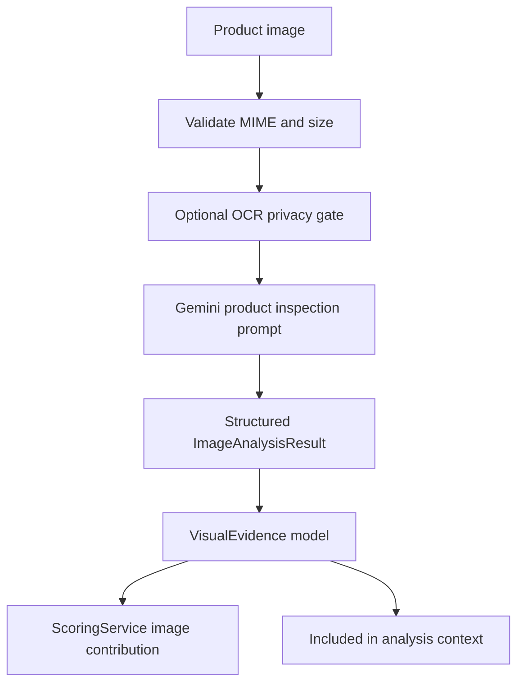
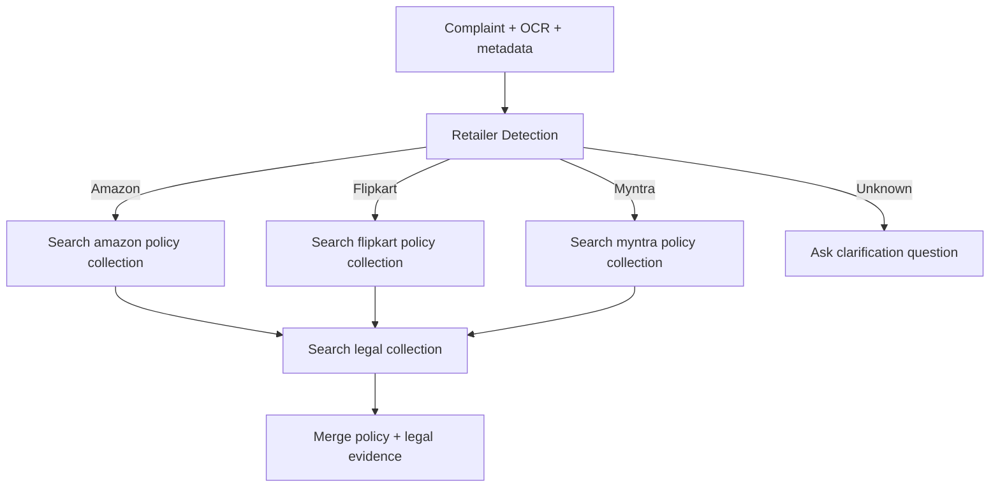
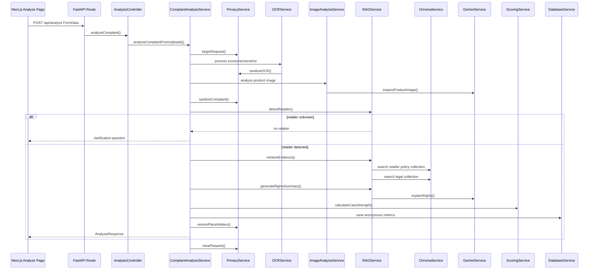

# RightsAI / ConsumerSheildAI Technical Implementation Guide

**Audience:** technical interview preparation, architecture review, and rebuild planning.  
**Project type:** full-stack, evidence-based consumer-rights evaluation platform.  
**Core idea:** help users understand consumer disputes through OCR, multimodal evidence analysis, retailer-specific RAG, deterministic scoring, and privacy-first AI orchestration.

> Naming note: the product began as **RightsAI** and is currently branded in the UI/API as **ConsumerSheildAI**. In this guide, RightsAI refers to the system concept and ConsumerSheildAI refers to the implemented app brand.

---

## Table of Contents

1. Executive Summary
2. Product Problem and Design Goal
3. High-Level Architecture
4. Folder Structure
5. Frontend Architecture
6. Backend Architecture
7. Service-Oriented and OOP Design
8. Privacy Protection Layer
9. OCR Pipeline
10. AI Product Image Analysis
11. RAG Pipeline and Retailer-Aware Retrieval
12. Gemini Integration
13. Deterministic Evaluation and Scoring
14. Database Design
15. API Contract and Request Lifecycle
16. Responsible AI and Explainability
17. LangChain Implementation: What Is Not Used and Why
18. Rebuild Guide From Scratch
19. Testing and Debugging Strategy
20. Technical Interview Preparation
21. Cheat Sheet

---

## 1. Executive Summary

RightsAI is not implemented as a generic chatbot. It is an **evidence-based rights navigator**. The application receives a consumer complaint plus optional invoices, screenshots, and product images. It then sanitizes private information, extracts text from images, inspects visual evidence, detects the retailer, retrieves relevant policies and legal clauses, generates a rights explanation, and calculates transparent case scores.

The most important architectural decision is that business logic is hidden behind dedicated service classes. API routes do not call Gemini, ChromaDB, OCR, or SQLite directly. They delegate to a controller, and the controller delegates to services.

### Core Capabilities

| Capability | Implementation |
|---|---|
| User interface | Next.js 15 App Router, TypeScript, Tailwind CSS, shadcn-style components |
| Backend API | FastAPI with multipart upload endpoints |
| LLM | Google Gemini through `GeminiService` |
| Embeddings | Gemini embeddings when configured, deterministic local fallback otherwise |
| Vector database | ChromaDB persistent collections |
| OCR | EasyOCR wrapped by `OCRService` |
| Multimodal image analysis | Gemini Vision through `ImageAnalysisService` and `GeminiService.inspectProductImage()` |
| Privacy | Request-local masking in `PrivacyService` before AI calls |
| Scoring | Deterministic `ScoringService`, not LLM-generated |
| Persistence | SQLite through `DatabaseService`, storing anonymous case metrics only |

### Interview Summary

If asked to summarize the project in one minute:

> RightsAI is a full-stack consumer-rights evaluation platform. The frontend collects complaint text and evidence uploads. FastAPI receives the request, masks PII, runs OCR and product image analysis, detects the retailer, performs retailer-restricted RAG with ChromaDB, asks Gemini only for explanation generation, then calculates evidence completeness and case strength through deterministic scoring rules. The system is intentionally neutral: it can return strong, moderate, weak, or unlikely verdicts rather than always supporting the user.

---

## 2. Product Problem and Design Goal

Consumer complaints often contain unstructured facts: refund denial, wrong delivery, defective products, warranty disputes, delayed shipment, invoices, screenshots, and product photos. A normal chatbot can easily overstate a user’s legal position because it lacks evidence grounding and deterministic reasoning.

RightsAI solves this by separating the problem into measurable stages:

1. Collect user complaint and uploads.
2. Remove personal data before AI processing.
3. Extract text from invoices or screenshots.
4. Inspect non-text product images for visible evidence.
5. Detect the retailer.
6. Retrieve only that retailer’s policies.
7. Retrieve legal documents separately.
8. Generate a rights explanation from bounded context.
9. Score the case using transparent programmatic rules.
10. Show the verdict, missing evidence, and recommended next action.

### Why This Matters

The app is designed around fairness. It should not assume the consumer is correct. It considers evidence, retailer policies, legal clauses, timelines, and missing proof before recommending escalation.

> **Interview tip:** Use the phrase “neutral advisor, not automatic advocate.” It communicates the product philosophy clearly.

---

## 3. High-Level Architecture



### Main Architectural Layers

| Layer | Responsibility | Example Files |
|---|---|---|
| Frontend | User workflow, uploads, results dashboard | `frontend/app/analyze/page.tsx` |
| API routes | HTTP boundary and request parsing | `backend/app/api/routes.py` |
| Controller | Thin delegation layer | `backend/app/controllers/analysis_controller.py` |
| Services | Business logic and external integrations | `backend/app/services/*` |
| RAG package | Loading, chunking, embedding, vector retrieval | `rag/*` |
| Knowledge base | Legal and retailer policy documents | `knowledge_base/*` |
| Database | Anonymous metrics storage | SQLite via SQLAlchemy |

### Why This Architecture Was Chosen

The system has multiple complex concerns: OCR, privacy, embeddings, vector search, LLM prompting, scoring, and persistence. Putting these directly in routes would create a fragile backend. Service classes provide encapsulation: each external dependency is hidden behind a public interface.

---

## 4. Folder Structure

```text
project-root/
  frontend/
    app/
      page.tsx
      analyze/page.tsx
    components/
      ui/
    lib/
      utils.ts
    package.json
  backend/
    app/
      api/routes.py
      controllers/analysis_controller.py
      core/config.py
      models/schemas.py
      services/
        analysis_service.py
        database.py
        gemini_service.py
        image_analysis_service.py
        ocr_service.py
        privacy.py
        scoring_service.py
      main.py
    requirements.txt
  rag/
    chroma_service.py
    chunker.py
    document_loader.py
    embedding_service.py
    retrieval_service.py
  knowledge_base/
    legal/
    policies/
      amazon/
      flipkart/
      myntra/
  database/
  uploads/
  docs/
```

### Folder Decisions

| Folder | Why it exists |
|---|---|
| `frontend/` | Keeps web UI isolated from backend implementation details. |
| `backend/app/api/` | Defines HTTP endpoints only. |
| `backend/app/controllers/` | Converts route calls into service calls. |
| `backend/app/services/` | Encapsulates business logic and external tools. |
| `rag/` | Keeps vector retrieval concerns separate from API/business orchestration. |
| `knowledge_base/` | Stores source material used for retrieval. |
| `database/` | Holds local SQLite state. |
| `uploads/` | Temporary file processing area for OCR/image uploads. |
| `docs/` | Project documentation artifacts. |

> **Best practice:** A folder structure should reflect architectural boundaries, not just file types. Here, service boundaries are explicit.

---

## 5. Frontend Architecture

The frontend uses Next.js 15 with App Router. The main interaction lives in `frontend/app/analyze/page.tsx`.

### Frontend Responsibilities

- Render complaint input fields.
- Accept invoice, screenshot, and product image uploads.
- Submit a multipart request to the backend.
- Display case category, verdict, evidence completeness, case strength, timeline analysis, OCR text, image analysis, evidence sources, recommended actions, and complaint drafts.
- Show privacy and responsible AI notices.

### Frontend Request Flow



### Why the Frontend Does Not Call Gemini

The frontend never calls Gemini directly because:

1. API keys must not be exposed in browser code.
2. Privacy masking must happen before AI inference.
3. RAG retrieval and scoring require backend services.
4. The backend controls auditability and deterministic rules.

### UI Design Decisions

The UI follows a SaaS dashboard pattern rather than a chat interface. This is important because the product goal is evaluation, not conversation. Results are structured into cards and panels so users can see:

- What the system concluded.
- Why it concluded that.
- What evidence was used.
- What evidence is missing.
- What the next action should be.

> **Interview tip:** If asked why this is not a chatbot, say that the UX is optimized for explainable decision support, not open-ended dialogue.

---

## 6. Backend Architecture

The backend is a FastAPI application. The main route file is `backend/app/api/routes.py`.

### API Endpoints

| Endpoint | Method | Purpose |
|---|---|---|
| `/api/health` | GET | Health check for frontend/backend connectivity. |
| `/api/ocr/extract` | POST | Extract OCR text from one uploaded file. |
| `/api/analyze` | POST | Run the full complaint analysis workflow. |

### Backend Request Boundary

`/api/analyze` accepts multipart form data:

- `complaint_text`: required text field.
- `invoice`: optional upload.
- `screenshot`: optional upload.
- `product_image`: optional upload.

The route delegates immediately to `AnalysisController`. The controller delegates to `ComplaintAnalysisService`.



### Why Thin Routes Matter

Thin routes improve maintainability. The API layer should know how to receive HTTP data, but not how OCR, RAG, Gemini, scoring, or privacy work internally.

---

## 7. Service-Oriented and OOP Design

The backend uses object-oriented encapsulation through service classes. Each service owns its private state and exposes only public methods needed by other layers.

### Service Map

| Service | Public Role | Hidden Internals |
|---|---|---|
| `ComplaintAnalysisService` | Orchestrates full workflow | Service dependencies and workflow order |
| `PrivacyService` | Sanitizes and restores placeholders | Regex patterns, request-local mapping, counters |
| `OCRService` | Extracts text from uploads | EasyOCR reader, temp file handling, cleanup |
| `ImageAnalysisService` | Validates and analyzes product images | MIME checks, size checks, Gemini vision call |
| `RAGService` | Retailer detection, retrieval, summary generation | Chroma collections and Gemini interaction |
| `ChromaService` | Add/search/delete vector documents | Chroma client, collections, embedding model |
| `GeminiService` | Classify/explain/generate/analyze image | API key, model, prompt templates, response parsing |
| `ScoringService` | Calculate evidence and case strength | Timeline rules, regex checks, penalties |
| `DatabaseService` | Save anonymous case metrics | SQLAlchemy engine/session/table definitions |

### Encapsulation Example

The controller calls:

```python
return await self._analysisService.analyzeComplaintFromUploads(
    complaint_text, invoice, screenshot, product_image
)
```

It does not know:

- How EasyOCR runs.
- How Gemini prompts are constructed.
- How ChromaDB collections are named.
- How scores are calculated.
- How SQLite sessions are managed.

That is data wrapping: internal details are private to services.

### Design Patterns Used

| Pattern | Where it appears | Why it helps |
|---|---|---|
| Facade | `ComplaintAnalysisService` | One public workflow hides many subsystems. |
| Service Layer | `backend/app/services/*` | Keeps business logic out of routes. |
| Repository-like wrapper | `DatabaseService`, `ChromaService` | Encapsulates persistence details. |
| Dependency Injection by constructor defaults | Service constructors | Allows replacement in tests. |
| DTO / Schema | Pydantic models in `schemas.py` | Stable API response contract. |
| Strategy-like scoring helpers | `ScoringService` private methods | Keeps scoring rules modular. |

> **Interview tip:** Explain that this is not pure textbook OOP with deep inheritance. It uses practical OOP: composition, encapsulation, and small public interfaces.

---

## 8. Privacy Protection Layer

Privacy is a core Responsible AI feature. The system must ensure Gemini does not receive raw personally identifiable information.

### Privacy Flow



### PII Types Masked

`PrivacyService` detects and masks:

- Email addresses.
- Phone numbers.
- Credit card-like numbers.
- UPI IDs.
- Order IDs.
- Invoice IDs.
- Customer IDs.
- Tracking IDs.
- Bank account-like numbers.
- Addresses.
- PIN codes.
- Person names in common phrases such as “my name is Rahul Sharma”.

### Placeholder Example

Original:

```text
My name is Rahul Sharma. Order ID OD3489234. Phone 9876543210.
```

Sanitized:

```text
My name is [PERSON_1]. Order ID [ORDER_ID_1]. Phone [PHONE_1].
```

### Request-Local Mapping

The implementation uses Python `ContextVar` objects so placeholder mappings are isolated per request. This is important in asynchronous FastAPI environments where multiple requests may be processed concurrently.

### Why Restore Only After AI

Gemini receives placeholders only. After Gemini returns, `ComplaintAnalysisService._restoreResponsePlaceholders()` restores placeholders in UI-facing text. This gives the user a readable response without exposing raw PII to the model.

### Database Privacy

The database should store only anonymous metrics:

- Anonymous session ID.
- Complaint category.
- Case strength score.
- Evidence score.
- Policy matches.
- Timestamp.

It should not store raw complaint text, phone numbers, emails, addresses, payment data, or names.

> **Interview tip:** Call this “data minimization” and “privacy by design.”

---

## 9. OCR Pipeline

The OCR pipeline is wrapped by `OCRService`.

### OCR Flow



### Why OCR Exists

Consumer evidence often appears in screenshots or invoices. OCR turns that visual text into searchable, retrievable, and explainable context.

### OCR Responsibilities

- Read uploaded image bytes.
- Save temporary file for OCR processing.
- Run EasyOCR.
- Calculate text confidence.
- Clean extracted text.
- Mask PII before storage or Gemini use.
- Remove temporary files after processing.

### OCR Limitations

OCR helps only when the image contains text. A broken shoe or cracked screen may contain little text, so the system also supports visual product inspection through Gemini Vision.

---

## 10. AI Product Image Analysis

Product images are handled by `ImageAnalysisService` and `GeminiService.inspectProductImage()`.

### Why Image Analysis Was Added

OCR cannot analyze a damaged product with no visible text. The image analysis module detects visible evidence such as:

- Detached soles.
- Cracked screens.
- Broken packaging.
- Wrong product indicators.
- Counterfeit signs when visually observable.
- Delivery damage.

### Image Analysis Flow



### Responsible Vision Prompting

The prompt instructs Gemini to:

- Identify only what is visually observable.
- Never assume warranty eligibility.
- Never determine legal liability.
- Never conclude the consumer is correct.
- Mention uncertainty when appropriate.

This is an important guardrail. Image analysis supports evidence evaluation, but it does not prove legal responsibility by itself.

### Case Strength Contribution

The image module returns a bounded contribution:

| Visual Finding | Case Strength Contribution |
|---|---:|
| Contradiction | -15 |
| No visible damage | 0 |
| Minor/moderate damage | +10 |
| High/severe/critical damage | +20 |

This keeps image evidence influential but not absolute.

---

## 11. RAG Pipeline and Retailer-Aware Retrieval

RAG means Retrieval-Augmented Generation. RightsAI retrieves policy and legal context before asking Gemini to explain the user’s rights.

### RAG Components

| File | Responsibility |
|---|---|
| `rag/document_loader.py` | Loads legal and retailer policy documents. |
| `rag/chunker.py` | Splits documents into smaller searchable chunks. |
| `rag/embedding_service.py` | Creates embeddings with Gemini or local fallback. |
| `rag/chroma_service.py` | Stores and searches vector collections. |
| `rag/retrieval_service.py` | Detects retailer, retrieves evidence, calls Gemini summary. |

### Retailer-Aware Retrieval

The system supports Amazon, Flipkart, and Myntra. It must not search all retailer policies simultaneously. Instead:

1. Detect retailer from complaint, OCR, visual context, and metadata.
2. If one retailer is detected, search only that retailer’s policy collection.
3. Always search legal collections separately.
4. If no retailer is detected, ask the user for clarification.



### Why Retailer Restriction Matters

If a complaint says “I bought shoes from Myntra,” retrieving Amazon policy clauses would be misleading. Retailer-restricted retrieval improves precision and fairness.

### Legal Retrieval Is Separate

Legal retrieval always searches:

- Consumer Protection Act 2019.
- E-Commerce Rules 2020.
- NCH Guidelines.

This separation keeps retailer policy and statutory rights conceptually distinct.

---

## 12. Gemini Integration

All Gemini interaction is wrapped by `GeminiService`.

### GeminiService Public Methods

| Method | Purpose |
|---|---|
| `classifyComplaint()` | Returns category and confidence. In this implementation, it delegates to deterministic keyword classification. |
| `explainRights()` | Generates structured rights explanation using retrieved evidence. |
| `generateComplaintLetter()` | Generates simple complaint draft templates. |
| `summarizeEvidence()` | Converts visual evidence into a short summary. |
| `inspectProductImage()` | Sends product image bytes to Gemini Vision and parses structured JSON. |

### Why Wrap Gemini

The wrapper prevents the rest of the app from knowing:

- API key handling.
- Model name.
- Prompt format.
- Retry behavior.
- JSON parsing.
- Safety instructions.
- Privacy re-sanitization.

### Gemini Is Not Used for Scoring

A key design rule is that Gemini must not generate the final scores. Gemini can classify or explain, but deterministic scoring happens in `ScoringService`.

> **Interview tip:** Say, “The LLM is used for language and interpretation, while final scoring is deterministic and auditable.”

---

## 13. Deterministic Evaluation and Scoring

RightsAI uses two independent scores.

### 1. Evidence Completeness Score

Measures how much supporting evidence exists. It does not determine whether the user will win.

Inputs include:

- Invoice uploaded.
- Screenshot uploaded.
- OCR extracted.
- Order ID present.
- Retailer identified.
- Customer support communication available.

### 2. Consumer Case Strength Score

Measures whether the available facts support a valid consumer-rights claim.

Inputs include:

- Return window validity.
- Warranty validity.
- Defective product evidence.
- Wrong product evidence.
- Seller policy violation.
- Consumer rights support.
- Timeline consistency.
- Relevant policy support.
- Product image inspection contribution.

### Negative Reasoning Engine

The scoring service actively looks for reasons the case may fail:

- Return window expired.
- Warranty expired.
- No defect described.
- No seller wrongdoing described.
- Missing proof of purchase.
- Missing support communication.
- No retailer policy support.
- No consumer-rights violation detected.
- Old purchase dates without defect evidence.

### Verdicts

| Score Range | Verdict |
|---:|---|
| 80-100 | Strong Consumer Claim |
| 60-79 | Moderate Claim |
| 40-59 | Weak Claim |
| 0-39 | Unlikely to Succeed |

### Why Deterministic Scoring Is Better

LLM-generated confidence can be arbitrary. Deterministic scoring is explainable because each component and penalty can be shown to the user.

### Example

Complaint:

```text
I bought shoes in 2024 and want to return them now.
```

Likely output:

- Evidence completeness may be high if invoice is present.
- Case strength may be low because return window likely expired and no defect is described.
- Verdict: Unlikely to Succeed.
- Recommendation: review retailer policy before escalation.

This is the correct neutral behavior.

---

## 14. Database Design

`DatabaseService` wraps SQLite access through SQLAlchemy.

### Stored Data

The database stores anonymous case analytics, not raw user content.

| Column | Purpose |
|---|---|
| anonymous_session_id | Non-identifying session reference. |
| category | Classified complaint category. |
| case_strength_score | Deterministic score. |
| evidence_score | Evidence completeness score. |
| policy_matches | Retrieved policy titles. |
| created_at | Timestamp. |

### Why SQLite

SQLite is appropriate for local development and lightweight case analytics. For production, this layer could be replaced with Postgres without changing controllers because database logic is encapsulated.

---

## 15. API Contract and Request Lifecycle

### Full Request Lifecycle



### Response Shape

The backend returns `AnalysisResponse`, including:

- `retailer`
- `needs_clarification`
- `case_category`
- `rights_summary`
- `reasons`
- `evidence_sources`
- `evidence_completeness_score`
- `consumer_case_strength_score`
- `case_verdict`
- `timeline_analysis`
- `case_strength_explanation`
- `recommended_actions`
- `recommended_next_action`
- `email_draft`
- `complaint_letter`
- `extracted_text`
- `visual_evidence`
- `image_analysis`
- `disclaimer`

---

## 16. Responsible AI and Explainability

RightsAI includes several responsible AI principles by design.

### Responsible AI Features

| Principle | Implementation |
|---|---|
| Privacy | PII masking before Gemini calls. |
| Data minimization | Database stores anonymous metrics only. |
| Explainability | Evidence sources, reasons, scoring breakdown, timeline analysis. |
| Fairness | Negative reasoning engine can return weak or unlikely verdicts. |
| Grounding | RAG retrieves retailer policy and legal clauses. |
| Human control | UI presents guidance and disclaimer, not legal commands. |

### Disclaimer

The response includes:

> This platform provides informational guidance and does not constitute legal advice.

### Explainability Panels

A good result page should answer:

1. What is the category?
2. What evidence was considered?
3. What policies or laws were retrieved?
4. Why is the score high or low?
5. What is missing?
6. What should the user do next?

---

## 17. LangChain Implementation: What Is Not Used and Why

This project currently **does not implement LangChain**.

There are no LangChain chains, agents, tools, memory modules, retrievers, LCEL graphs, or `ChatPromptTemplate` objects in the application. Instead, RightsAI uses a custom service-based orchestration layer.

### What Replaces LangChain Here

| LangChain Concept | RightsAI Equivalent |
|---|---|
| LLM wrapper | `GeminiService` |
| Retriever | `RAGService` + `ChromaService.searchDocuments()` |
| Vector store abstraction | `ChromaService` |
| Prompt templates | String templates inside `GeminiService` |
| Output parser | Pydantic model validation and JSON parsing |
| Chain orchestration | `ComplaintAnalysisService` |
| Memory | Not used; request-local privacy mapping only |
| Tools/agents | Not used; deterministic service calls instead |

### Why Not LangChain

The custom implementation is reasonable because:

1. The workflow is deterministic and fixed.
2. The app needs strict privacy control before every Gemini call.
3. Retailer-aware retrieval has custom rules.
4. Scoring must be deterministic and auditable.
5. A smaller abstraction surface is easier to explain and debug.

### How To Explain This In An Interview

If asked “Where is LangChain used?”, answer honestly:

> The current implementation does not use LangChain. We intentionally built a custom service orchestration layer because the workflow is fixed, privacy-sensitive, and score-critical. Gemini access is encapsulated in `GeminiService`, retrieval in `RAGService` and `ChromaService`, and final scoring in `ScoringService`. If the project later needed dynamic agent behavior, tool calling, or complex chain composition, LangChain could be introduced behind the existing service interfaces.

### How LangChain Could Be Added Later

A future version could replace internals while preserving the public services:

- `GeminiService` could wrap a LangChain chat model.
- `RAGService.retrieveEvidence()` could use a LangChain retriever.
- Pydantic output parsing could use LangChain structured output.
- The public API would remain stable because controllers still call services.

> **Best practice:** Do not add LangChain just to say the project uses LangChain. Add it only when it reduces complexity or enables needed capabilities.

---

## 18. Rebuild Guide From Scratch

### Step 1: Create the Frontend

1. Create a Next.js 15 TypeScript app.
2. Add Tailwind CSS.
3. Build the landing page.
4. Build `/analyze` with complaint text and upload controls.
5. Submit multipart `FormData` to backend `/api/analyze`.
6. Render dashboard cards from `AnalysisResponse`.

### Step 2: Create the FastAPI Backend

1. Create FastAPI app with `/api/health`, `/api/ocr/extract`, `/api/analyze`.
2. Define Pydantic schemas.
3. Add controller layer.
4. Keep routes thin.

### Step 3: Add PrivacyService

1. Implement regex masking.
2. Store placeholder mappings in request-local memory.
3. Sanitize complaint and OCR text before Gemini.
4. Restore placeholders only after model response.

### Step 4: Add OCRService

1. Accept uploads.
2. Run EasyOCR.
3. Clean text.
4. Sanitize OCR text.
5. Return text and confidence.

### Step 5: Add RAG

1. Create knowledge-base markdown files.
2. Load documents.
3. Chunk documents.
4. Generate embeddings.
5. Store retailer policies in separate Chroma collections.
6. Store legal documents in a separate collection.
7. Restrict policy retrieval by detected retailer.

### Step 6: Add GeminiService

1. Wrap API key and model config.
2. Add prompt templates.
3. Add strict JSON parsing.
4. Re-sanitize prompt inputs.
5. Provide fallback behavior if Gemini is unavailable.

### Step 7: Add ScoringService

1. Implement evidence completeness score.
2. Implement case strength score.
3. Add negative reasoning penalties.
4. Add timeline extraction.
5. Generate verdict and next action.

### Step 8: Add DatabaseService

1. Create SQLite database.
2. Store anonymous metrics only.
3. Do not store raw PII or complaint text.

### Step 9: Integrate

`ComplaintAnalysisService` should orchestrate everything:

```text
Privacy -> OCR -> Image Analysis -> Retailer Detection -> RAG -> Gemini Explanation -> Scoring -> DB -> Restore Output
```

### Step 10: Verify

- Start backend.
- Start frontend.
- Check `/api/health`.
- Submit text-only complaint.
- Submit complaint with invoice screenshot.
- Submit product damage image.
- Test unknown retailer clarification.
- Test old purchase date negative verdict.

---

## 19. Testing and Debugging Strategy

### Backend Tests To Add

| Test | Expected Result |
|---|---|
| PII masking | Gemini receives placeholders, not raw PII. |
| Retailer detection | Myntra complaint retrieves only Myntra policies. |
| Unknown retailer | Returns clarification question. |
| Old purchase date | Penalizes case strength. |
| OCR text | Sanitized before analysis. |
| Image analysis | Structured JSON maps to `ImageAnalysisResult`. |
| Database save | Stores no raw complaint text. |

### Common Runtime Issues

| Symptom | Likely Cause | Debug Step |
|---|---|---|
| Frontend “failed to fetch” | Backend not running or wrong API URL | Check `/api/health` and frontend API base URL. |
| OCR slow at startup | EasyOCR model loading | Wait for backend startup, check logs. |
| Gemini returns no result | Missing API key or invalid JSON | Check `GEMINI_API_KEY` and fallback response. |
| No policy retrieval | Retailer not detected | Add retailer name or inspect OCR text. |
| Weak score despite evidence | Timeline expired or no violation described | Review scoring breakdown. |

### Logging To Keep

Useful logs include:

- Detected retailer.
- Policy documents retrieved.
- Legal documents retrieved.
- Sanitized text only, never raw complaint.

---

## 20. Technical Interview Preparation

### Question: Why did you use FastAPI?

FastAPI gives strong request validation, simple multipart upload support, async endpoints, and clean integration with Pydantic schemas. It is a good fit for an AI backend that needs structured JSON contracts.

### Question: Why Next.js?

Next.js provides a modern React app structure, good routing, TypeScript support, and production-friendly frontend conventions. The app uses it for a responsive dashboard interface.

### Question: Why ChromaDB?

ChromaDB is simple for local vector persistence and works well for a project-scale RAG knowledge base. The app wraps Chroma behind `ChromaService`, so a production vector database could replace it later.

### Question: Why not retrieve all policies?

Retrieving all retailers would create misleading context. If the complaint is about Myntra, Amazon policy should not affect the answer. The app detects retailer first and retrieves only that retailer’s policies, while legal retrieval remains separate.

### Question: Why not let Gemini decide confidence?

LLM confidence is not reliable. The app calculates scores deterministically from visible factors such as evidence, dates, policy matches, and missing proof. This makes the result explainable.

### Question: How is privacy guaranteed?

All AI-bound text passes through `PrivacyService`, which masks PII with placeholders. The mapping is held only in request-local memory and cleared after the request. Gemini receives sanitized text.

### Question: What happens when Gemini is unavailable?

The app has fallback behavior for rights analysis and deterministic scoring. Some vision features may be unavailable, but the backend can still return a structured response.

### Question: What are the main tradeoffs?

| Decision | Benefit | Tradeoff |
|---|---|---|
| Custom services instead of LangChain | More control and simpler debugging | More custom code to maintain |
| SQLite | Easy local setup | Not ideal for high-scale production |
| Regex privacy masking | Fast and explainable | Less accurate than full NER for every name/address |
| Deterministic scoring | Transparent | Requires careful rule tuning |
| EasyOCR | Local OCR support | Model loading can be heavy |

### Question: How would you scale this?

- Move SQLite to Postgres.
- Move uploads to object storage.
- Add background jobs for OCR and image analysis.
- Add auth and tenant isolation.
- Add observability and structured logs.
- Add automated evaluation datasets for RAG and scoring.
- Use managed vector DB if data grows.
- Add rate limiting and abuse protection.

---

## 21. Cheat Sheet

### One-Line Architecture

Next.js sends complaint evidence to FastAPI, which sanitizes PII, extracts OCR, analyzes images, retrieves retailer-specific policies and legal clauses from ChromaDB, asks Gemini for explanation, computes deterministic scores, stores anonymous metrics, and returns an explainable dashboard response.

### Most Important Files

| File | Why it matters |
|---|---|
| `frontend/app/analyze/page.tsx` | Main user workflow and dashboard. |
| `backend/app/api/routes.py` | API endpoints. |
| `backend/app/controllers/analysis_controller.py` | Thin controller boundary. |
| `backend/app/services/analysis_service.py` | Main orchestration facade. |
| `backend/app/services/privacy.py` | PII masking and restoration. |
| `backend/app/services/gemini_service.py` | Gemini API wrapper. |
| `backend/app/services/scoring_service.py` | Deterministic verdict engine. |
| `backend/app/services/image_analysis_service.py` | Product image inspection workflow. |
| `rag/retrieval_service.py` | Retailer-aware RAG. |
| `rag/chroma_service.py` | ChromaDB encapsulation. |
| `backend/app/models/schemas.py` | Response contracts. |

### Key Interview Phrases

- “Evidence-based rights navigator, not a chatbot.”
- “Neutral advisor, not automatic consumer advocate.”
- “LLM for explanation, deterministic backend for scoring.”
- “Retailer-aware RAG prevents irrelevant policy contamination.”
- “Privacy by design through request-local placeholder masking.”
- “Service classes encapsulate Gemini, ChromaDB, OCR, and SQLite.”
- “No LangChain is currently used; custom orchestration was chosen for control.”

### Final Mental Model

Think of RightsAI as a pipeline:

```text
Collect evidence
  -> sanitize PII
  -> extract text and visual observations
  -> detect retailer
  -> retrieve grounded context
  -> generate explanation
  -> score deterministically
  -> return transparent verdict
```

That mental model is enough to rebuild the system module by module.
